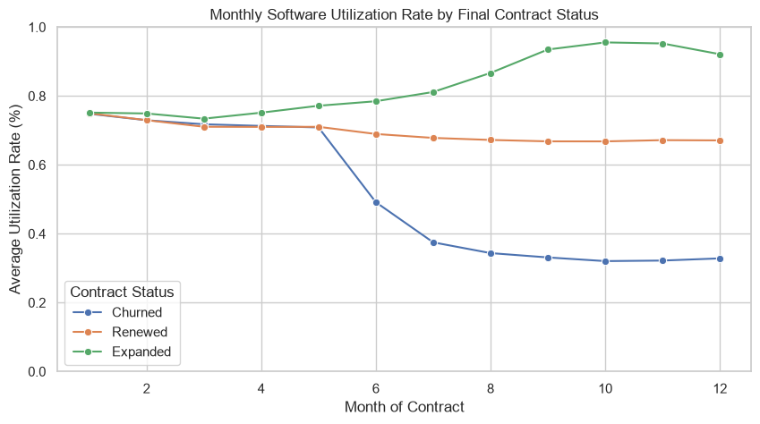
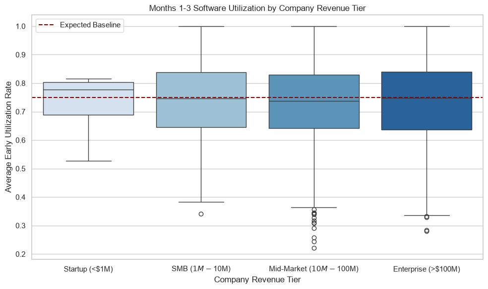
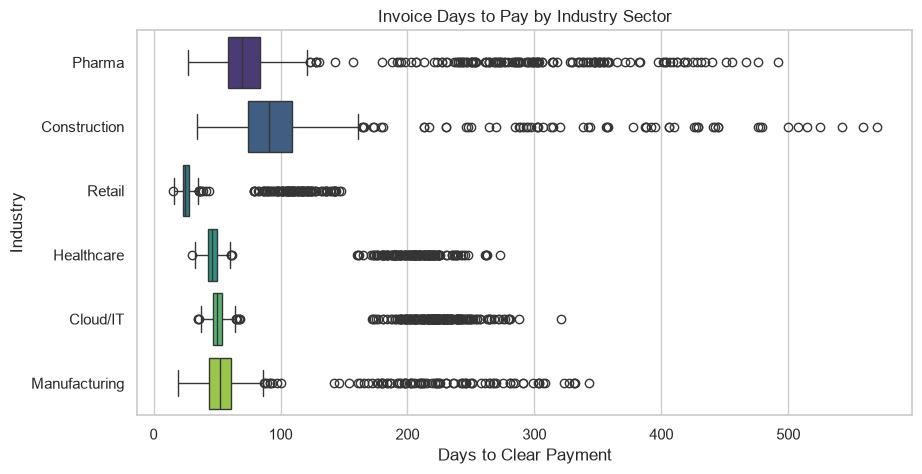
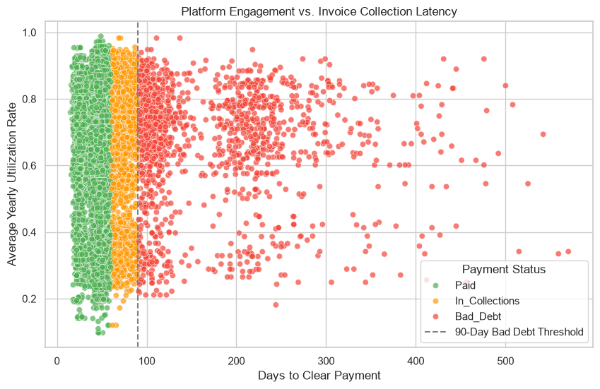

# Subscription Finance Analytics: Synthetic Data Generator + EDA

A synthetic dataset generator for an enterprise B2B SaaS business, plus an analysis of the data it produces: churn, MRR, expansion revenue, deferred revenue, and collections.

The generator bakes in **hidden variables** (legacy tech debt, executive champion turnover, cashflow distress) and then drops them before export. The analysis then shows how you can still detect their effects using only the observable data.

Built by **Chass Miguel E. Mesina** and **Margrette Sofia M. Hidalgo** during the Eskwelabs Innovation Fellowship (Cohort 10, Data Modeling), June–July 2026.

## What's inside

| File | What it is |
|---|---|
| [`docs/synthetic_data_model.md`](docs/synthetic_data_model.md) | The data model: schema, data dictionary, and the math behind every table |
| [`02_synthetic_data_generator.ipynb`](02_synthetic_data_generator.ipynb) | Generates 7 related tables (5,000 customers, 60,000 usage events) |
| [`03_data_analytic_showcase.ipynb`](03_data_analytic_showcase.ipynb) | Descriptive and diagnostic analysis of the generated data |
| [`sample_data/`](sample_data/) | First 100 rows of each table, for a quick look without running anything |

## The dataset

Seven tables that link together like a real SaaS company's data:

`Customers` → `Subscriptions` → `UsageEvents`, `Invoices` → `Payments`, `RevenueSchedules`, plus a `ProductPlans` catalog.

How it's generated:
- **Company revenue (ARR):** log-normal, so many small companies and a few huge ones
- **Contract pricing:** power-law curve on company size, with industry modifiers and noise
- **Monthly usage:** mean-reverting AR(1) time series, hit by onboarding friction and a mid-year turnover shock
- **Churn:** logistic model on Q4 usage
- **Days to pay:** gamma distribution per industry, with a multiplier for distressed companies
- **Revenue recognition:** ACV recognized evenly over 12 months, with the deferred revenue balance tracked monthly

## Key findings

**Churned accounts fall off a cliff around month 6.** Renewed and expanded accounts stay steady or grow.



**Low early usage is an onboarding problem, not a product problem.** Smaller companies, which carry more legacy tech debt, start out slower.



**Pharma and Construction pay the slowest.** About 26% of billed revenue ends up in collections or written off as bad debt.



**Heavy users can still default.** Accounts that use the product a lot but pay late are a cash flow problem, so they need Collections, not Customer Success.



## Run it yourself

```bash
pip install -r requirements.txt
jupyter notebook
```

1. Run `02_synthetic_data_generator.ipynb`. It writes the 7 CSVs to this folder (seeded with `np.random.seed(42)`, so results are reproducible).
2. Run `03_data_analytic_showcase.ipynb`. It reads those CSVs.

Works in Google Colab too: upload both notebooks and run them in order.
