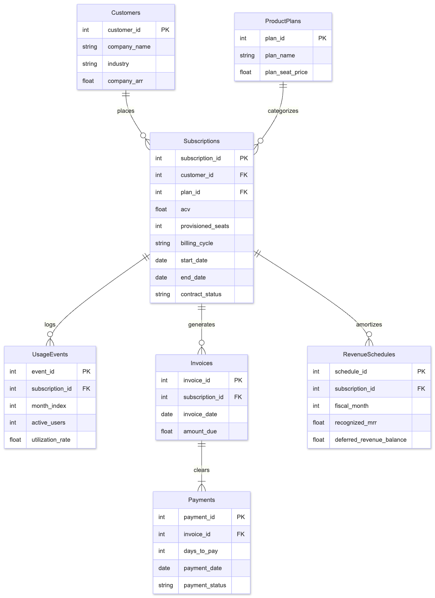
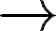
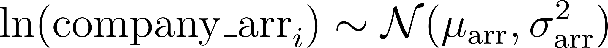
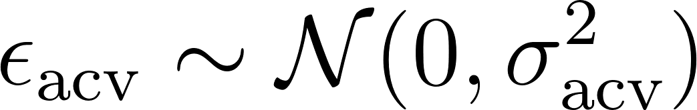
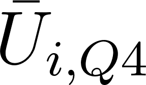
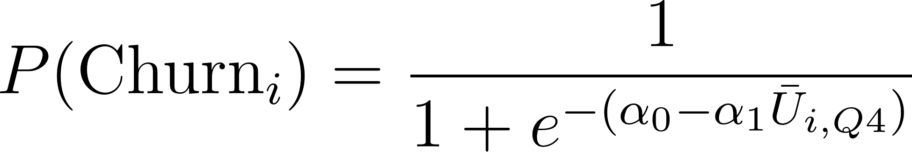
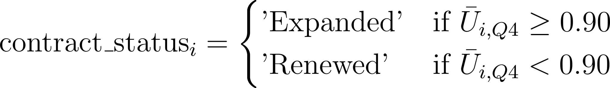
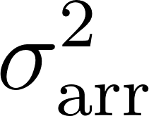
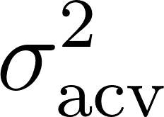

**Synthetic Data Model for Subscription Finance Analytics**

Eskwelabs Innovation Fellowship Cohort 10 \| Data Modeling

Chass Miguel E. Mesina and Margrette Sofia M. Hidalgo

June 2026

1.  **Introduction**

> This document outlines the structural and mathematical specifications for a synthetic dataset simulating a Enterprise B2B Software-as-a-Service (SaaS) subscription model. Designed for Eskwelabs learning sprints, this dataset provides a privacy-safe, mathematically rigorous environment for learners to practice subscription finance analytics.
>
> The primary objective of this data generator is to model realistic revenue lifecycle events, enabling learners to analyze Monthly Recurring Revenue (MRR), expansion revenue, deferred revenue, and customer churn. To ensure real-world fidelity, the data generation process incorporates industry-standard benchmarks for retention and payment collections. Furthermore, it introduces strategic "messiness" such as logging artifacts, payment failures, and latent (omitted) variables representing unobserved cashflow distress, legacy tech debt severity, and executive champion turnover, requiring learners to navigate confounding factors and incomplete information just as they would in a real-world data team.

2.  **Data Schema**

> The dataset consists of seven tables:

| **Table**        | **Description**            |
|------------------|----------------------------|
| Customers        | The client accounts        |
| ProductPlans     | The software catalog       |
| Subscriptions    | The commercial contracts   |
| UsageEvents      | Product telemetry          |
| Invoices         | Financial billing tracking |
| Payments         | Liquid cash collections    |
| RevenueSchedules | Advanced revenue ledger    |

3.  **Schema Diagram**

4.  **Data Dictionary**

    1.  **Customers**

| **Attribute** | **Data Type** | **Key Type** | **Description** | **Remarks** |
|----|----|----|----|----|
| customer_id | Integer | PK | Unique enterprise client ID | Auto-increment primary key |
| company_name | String | None | Recognizable corporate buyer names (e.g., "Spotify", "Boeing") | Programmatically sampled from a predefined list matching the industry column to ensure contextual realism. |
| industry | String | None | Business sector: \[Cloud/IT, Pharma, Healthcare, Retail, Manufacturing, Construction\] | **Root Driver 1:** Directly impacts how fast corporate bills get paid via the heavy-tailed Gamma distribution mapping to Payments.days_to_pay. |
| company_arr | Float | None | Total annual revenue of the client company | **Root Driver 2:** Modeled using a Log-Normal distribution. Massive companies buy massive software contracts. |

2.  **ProductPlans**

| **Attribute** | **Data Type** | **Key Type** | **Description** | **Remarks** |
|----|----|----|----|----|
| plan_id | Integer | PK | Unique plan identifier | Hardcoded look-up table |
| plan_name | String | None | Name of corporate tier | \['Growth Tier', 'Enterprise Tier'\] |
| plan_seat_price | Float | None | Price per seat license per month | e.g., \$45.00/seat/ month |

3.  **Subscriptions**

| **Attribute** | **Data Type** | **Key Type** | **Description** | **Remarks** |
|----|----|----|----|----|
| subscription_id | Integer | PK | Unique legal contract number | Auto-increment |
| customer_id | Integer | FK | Links to the purchasing client | Maps to Customers.customer_id |
| plan_id | Integer | FK | Links to the selected product tier | Maps to ProductPlans. plan_id |
| acv | Float | None | Annual Contract Value | Linked to Customers.company_arr: Calculated as a function of client size + industry modifiers + noise |
| provisioned_seats | Integer | None | Total number of user licenses bought | Derived from acv / (plan_seat_price \* 12) |
| billing_cycle | String | None | \['Annual Upfront', 'Quarterly'\] | Linked to acv: Small contracts pay quarterly; large enterprise deals demand 100% upfront annual paymentsbase |
| start_date | Date | None | Contract activation date | Baseline date index |
| end_date | Date | None | Contract expiration date | Set programmatically to start_date + 365 days |
| contract_status | String | None | Outcome: \[Expanded, Renewed, Churned\] | **Dependent Target:** Determined by late-stage usage trends in UsageEvents |

4.  **UsageEvents**

| **Attribute** | **Data Type** | **Key Type** | **Description** | **Remarks** |
|----|----|----|----|----|
| event_id | Integer | PK | Unique telemetry log row ID | Multi-row time-series tracking |
| subscription_id | Integer | FK | Identifies the contract logging usage | Maps to Subscriptions.subscription_id |
| month_index | Integer | None | Runtime month of contract (1 to 12) | Tracks usage chronologically |
| active_users | Integer | None | Workforce logins recorded that month | Deterministic, derived as round(utilization_rate × provisioned_seats). Bounded by contract seat count. |
| utilization_rate | Float | None | Percentage of seats actively used | The stochastic root driver. Modeled as a mean-reverting AR(1) process anchored to μ_usage, incorporating onboarding penalty and turnover shock. |

5.  **Invoices**

| **Attribute** | **Data Type** | **Key Type** | **Description** | **Remarks** |
|----|----|----|----|----|
| invoice_id | Integer | PK | Unique ledger document number | Generated on billing events. |
| subscription_id | Integer | FK | Links invoice to specific contract | Maps to Subscriptions.subscription_id |
| invoice_date | Date | None | Date billing document was issued | Conditioned on contract start_date and billing_cycle dates |
| amount_due | Float | None | Total financial balance requested | Linked to acv & billing_cycle: Equals acv if annual upfront, or acv / 4 if quarterly. |

6.  **Payments**

| **Attribute** | **Data Type** | **Key Type** | **Description** | **Remarks** |
|----|----|----|----|----|
| payment_id | Integer | PK | Unique bank clearing tracking index | Financial transaction record |
| invoice_id | Integer | FK | Links directly to source invoice | Maps to Invoices.invoice_id |
| days_to_pay | Integer | None | Days elapsed from issuance to clear | Linked to Customers.industry: Modeled using a heavy-tailed Gamma distribution. Tech pays fast; Manufacturing shifts to slow Net-60/90 timelines. |
| payment_date | Date | None | Date cash settled in bank | Calculated using invoice_date + days_to_pay |
| payment_status | String | None | Status: \[Paid, In_Collections, Bad_Debt\] | **Collections Metric:** Triggers In_Collections if days_to_pay \> 60. Triggers Bad_Debt if \> 90 |

7.  **RevenueSchedules**

| **Attribute** | **Data Type** | **Key Type** | **Description** | **Remarks** |
|----|----|----|----|----|
| schedule_id | Integer | PK | Unique amortization line item ID | Advanced accounting sub-ledger |
| subscription_id | Integer | FK | Links to the underlying contract | Maps to Subscriptions.subscription_id |
| fiscal_month | Integer | None | Calendar month index (1 to 12) | Tracks accounting period |
| recognized_mrr | Float | None | Revenue legally earned this month | Earned monthly revenue: acv / 12 |
| deferred_revenue_balance | Float | None | Remaining liability cash balance | **Deferred Revenue Metric:** Decrements by recognized_mrr every month until it hits \$0 on Month 12 |

5.  **Omitted Variables**

    1.  **Unobserved Cashflow Distress**

> #0)
>
> Represents hidden financial instability:

- If True  triggers a massive multiplier on payment delays.

- Influences *days_to_pay* in the *Payments* table, pushing accounts into collections.

- Implication: Removing this variable hides the true cause of payment failure. The analyst will see highly active users whose companies suddenly stop paying their bills. Without this data, a predictive model will misclassify the issue as a simple invoice tracking failure rather than hidden corporate budget cuts.

  1.  **Legacy Tech Debt Severity**

> %7D%20%2B%20%5Cepsilon_%7B%5Ctext%7Btech%5C_debt%7D%7D#0)
>
> #0)
>
> Represents structural difficulty in installing the software due to the client’s outdated IT systems:

- Higher values  harder to deploy, artificially hindering early-month software utilization.

- Influences *utilization_rate* during Months 1 through 3 in the *UsageEvents* Table.

- Implication: Omitting this metric introduces a hidden bias where internal client issues are mistaken for product issues. The final model will show that low early usage strongly predicts end-of-year churn. Because the client’s poor internal IT infrastructure is hidden, the analyst will incorrectly conclude that the software is of poor quality or lacks product-market fit.

  1.  **Executive Champion Turnover**

> #0)
>
> Represents sudden resignation or termination of the specific executive who purchased the software:

- If True  forces a severe cliff-drop in software engagement halfway through the year.

- Influences late-stage *utilization_rate* in *UsageEvents* and directly forces contract_status to churn.

- Implication: This hidden variable acts as a sudden behavioral shock to the data. The analyst will observe accounts with perfect early usage and payment histories whose logins suddenly collapse mid-year without any warning signs. Because this internal management change is omitted, the final model is forced to rely purely on sudden usage drops to predict churn treating the symptom as the root cause.

6.  **Structural Model**

> The model combines observed variables and latent factors within a probabilistic framework, allowing realistic dependencies and confounding structures to emerge in the generated data. Data is generated sequentially across the 7 relational tables following a strict chronological order.

1.  **Customer Baseline Scale (Customers Table)**

> The Annual Recurring Revenue (company_arr) of a purchasing organization is heavily right-skewed and is modeled using a Log-Normal distribution:
>
> %20%5Csim%20%5Cmathcal%7BN%7D(%5Cmu_%7B%5Ctext%7Barr%7D%7D%2C%20%5Csigma%5E2_%7B%5Ctext%7Barr%7D%7D)#0)

2.  **Subscription Contract Pricing (Subscriptions Table)**

> The Annual Contract Value (acv) is a dependent structural variable driven directly by the customer's baseline size (company_arr), modified by their specific industry vertical and a random error term:
>
> %5E%7B%5Cbeta_1%7D%20%5Ctimes%20%5Ctext%7BIndustryModifier%7D%20%5Ctimes%20e%5E%7B%5Cepsilon_%7B%5Ctext%7Bacv%7D%7D%7D#0)
>
> #0)
>
> The total number of provisioned_seats is then derived as a direct function of the contract value divided by the cost per seat determined by their assigned product_plan multiplied by 12 months:
>
> 
>
> Because enterprise software contracts must align to integer seat values (), the continuous initial budget target () is converted into a discrete, step-quantized finalized contract value. This reflects real-world procurement constraints where companies purchase whole user licenses rather than fractional seat capacities. The realized annual contract value () is calculated as:
>
> 
>
> This multi-step round-trip mapping intentionally injects realistic business noise into the data. For smaller accounts, the floor operation creates an immediate downward step-adjustment to their target budget, preserving the discrete pricing increments encountered by data analysts in actual industry transaction ledgers.

3.  **Invoice Generation & Amount Due (Invoices Table)**

> Invoices are generated dynamically based on the subscription's contract value and the assigned billing_cycle (e.g., monthly vs. annual billing models). The invoice amount_due is calculated structurally as:
>
> 

4.  **Accounts Receivable & Collection Latency (Payments Table)**

> When an invoice is issued, the time it takes for a company to clear the balance (days_to_pay) is modeled using a Gamma distribution to prevent negative day counts and simulate a realistic long tail of late payments. To incorporate the hidden financial shock from Section V, we apply an exponential multiplier:
>
> %20%5Ctimes%20%5Cexp(1.5%20%5Ccdot%20C_i)#0)

5.  **Monthly Telemetry & Platform Utilization (UsageEvents Table)**

> Platform utilization tracks the percentage of provisioned seats that are actively engaged each month (). This is simulated as a mean-reverting Autoregressive AR(1) time-series process to ensure stable long-term equilibrium around a realistic product adoption baseline (). It seamlessly integrates a structural onboarding penalty driven by Legacy Tech Debt () during early months, alongside the sudden behavioral shock of Executive Champion Turnover () in later periods:

%20-%20%5Ctext%7BOnboardingPenalty%7D(T_i)%20-%20%5Ctext%7BTurnoverShock%7D(L_i)%20%2B%20%5Cepsilon_%7B%5Ctext%7Busage%7D%7D#0)

> %20%3D%20%5Cbegin%7Bcases%7D%20%5Cfrac%7BT_i%7D%7B20%7D%20%26%20%5Ctext%7Bif%20%7D%20t%20%5Cle%203%20%5C%5C%200%20%26%20%5Ctext%7Bif%20%7D%20t%20%3E%203%20%5Cend%7Bcases%7D#0)
>
> %20%3D%20%5Cbegin%7Bcases%7D%200.45%20%5Ccdot%20L_i%20%26%20%5Ctext%7Bif%20%7D%20t%20%5Cge%206%20%5C%5C%200%20%26%20%5Ctext%7Bif%20%7D%20t%20%3C%206%20%5Cend%7Bcases%7D#0)
>
> Where the monthly idiosyncratic innovation noise follows a Gaussian distribution, #0), and the initial state at  is initialized from a truncated normal distribution bounded between  and :
>
> #0)
>
> The absolute volume of monthly active users is subsequently derived as a deterministic structural variable bounded by total contract sizing:
>
> #0)

6.  **Contract Renewal Outcomes (Core Target Equation)**

> At the end of the 12-month contract cycle, the final classification for contract_status (Expanded, Renewed, or Churned) is determined via a multi-stage conditional framework. First, a client’s baseline probability of cancellation, #0), is calculated using a logistic probability framework based on their final quarter's average utilization rate (). If a stochastic Bernoulli trial confirms the account has churned, contract_status is assigned as 'Churned'. For accounts that successfully survive renewal, a deterministic threshold rule is applied to their Q4 platform engagement to separate flat renewals from organic account expansion:
>
> %20%3D%20%5Cfrac%7B1%7D%7B1%20%2B%20e%5E%7B-(%5Calpha_0%20-%20%5Calpha_1%20%5Cbar%7BU%7D_%7Bi%2C%20Q4%7D)%7D%7D#0)
>
> 

7.  **Parameter Specification**

| **Parameter** | **Value** | **Interpretation** |
|----|----|----|
|  | 17.5 | Average scale |
|  | 1.5 | Size spread |
|  | 4.0 | Pricing baseline |
|  | 0.5 | Power exponent |
|  | \[0.30, 0.15, 0.20, 0.15, 0.12, 0.08\] | Probability weight vector for customer industry sampling (Cloud/IT, Pharma, Healthcare, Retail, Manufacturing, Construction). Biases the cohort size toward heavy software-consuming industries rather than a perfectly flat distribution. |
|  | \[1.15, 1.05, 1.00, 0.95, 0.90, 0.85\] | A vector scaling contract budget power across 6 sectors (Cloud/IT, Pharma, Healthcare, Retail, Manufacturing, Construction). Premium values () reflect high software budget adoption in tech/medical fields, while fractional values () model procurement discounts driven by low-margin industries. |
|  | 0.05 | Variance parameter for contract negotiation. |
|  | \[100.0, 17.5, 92.0, 50.0, 17.5, 15.0\] | Vector of Gamma shape constants across the 6 sectors. Larger values (e.g., 100.0 for Cloud/IT) shift the baseline payment peak outward to match real-world accounting processing intervals. |
|  | \[0.5, 4.0, 0.5, 0.5, 3.0, 6.0\] | Vector of Gamma scale variances across the 6 sectors. Kept small (0.5) for highly automated fields (Cloud/IT, Retail, Healthcare) to mirror strict 15-day benchmark windows, and expanded up to 6.0 for institutional fields (Manufacturing, Pharma, Construction) to simulate highly volatile late-paying tails. |
|  | 0.75 | Persistent Memory |
|  | 0.75 | Baseline Target |
|  | 0.02 | Variance parameter for monthly usage. |
|  | 1.50 | Baseline Churn Risk |
|  | 4.50 | Usage Sensitivity |
|  | 0.06 | Baseline probability for unobserved cashflow distress () |
|  | 0.15 | Baseline probability for executive champion turnover () |
|  | 5.00 | Linear scale coefficient |

8.  **Distribution Summary**

<!-- -->

1.  Log-Normal Distribution

- We use this to model the annual recurring revenue (ARR) of companies. This creates a right-skewed shape. It generates a large volume of small businesses alongside a few massive enterprise clients.

%20%5Csim%20%5Cmathcal%7BN%7D(%5Cmu_%7Barr%7D%2C%20%5Csigma_%7Barr%7D%5E2)#0)

2.  Gamma Distribution

- We use this to model the days taken to clear invoices. This prevents negative time values. It simulates the long tail of late payments seen in business-to-business transactions.

> #0)

3.  Autoregressive AR(1) Process

- We use this to model monthly software utilization. This creates a mean-reverting time series. It ensures customer usage remains stable month-over-month. It anchors to a baseline mean while allowing for random noise and structural shocks.

> 

9.  **Sampling Procedure**

<!-- -->

1.  Initialize Parameters: Define the configuration space. Set seed variables and distribution parameters.

2.  Generate Independent Entities: Create the Customers and ProductPlans tables.

3.  Simulate Hidden Factors: Generate the omitted variables (\$C_i\$, \$T_i\$, and \$L_i\$).

4.  Generate Contracts: Build the Subscriptions table. Base this on customer scale and product tier rules.

5.  Generate Financial Ledgers: Build the Invoices and Payments tables. Base these on billing cycles and industry-specific delay rules.

6.  Generate Telemetry: Build the UsageEvents table using the AR(1) process. Factor in the omitted variables \$T_i\$ and \$L_i\$.

7.  Classify Outcomes: Determine the final contract_status based on fourth-quarter product usage.

8.  Clean Outputs: Drop the omitted variables. Export the final CSV files.

<!-- -->

10. **Realism Features**

> This synthetic dataset incorporates specific engineering decisions to simulate the messiness of actual business environments. These features matter when you build models for production environments, as they train analysts to handle imperfect data.

- Discrete Integer Quantization: The model converts continuous annual budget targets into discrete integer seat counts. This step-function reflects actual procurement constraints where companies purchase whole user licenses rather than fractional seat capacities.

- Heavy-Tailed Delays: The model generates invoice clearance times using a Gamma distribution. This prevents negative time values and simulates the long tail of late payments. Institutional sectors like Manufacturing experience structurally longer payment cycles than fast-paying sectors like Cloud/IT.

- Hidden Structural Confounders: The generation process explicitly models three omitted variables: Unobserved Cashflow Distress, Legacy Tech Debt, and Executive Champion Turnover. These variables inject behavioral shocks and onboarding penalties into the observable data. The generator drops these columns prior to final export, forcing analysts to diagnose root causes using only surface-level symptoms.

11. **Scope & Delimitations**

> **Scope**

1.  The dataset covers a single 12-month fiscal period for Enterprise B2B Software-as-a-Service contracts.

2.  It tracks monthly account-level platform utilization, financial billing, and legal contract status.

3.  The customer base spans six predefined industry verticals.

**Delimitations**

1.  The model does not simulate multi-year renewals. It terminates analysis at the end of the initial 12-month contract lifecycle.

2.  The dataset excludes individual user-level telemetry. It aggregates all usage events to the overarching corporate account level.

3.  The product catalog remains restricted to two distinct tiers (Growth and Enterprise) to maintain clear pricing boundaries.

**Differences Between SMB, Midmarket, and Enterprise AEs**

[<u>https://pipeline.zoominfo.com/sales/difference-between-smb-midmarket-enterprise-account-executives</u>](https://pipeline.zoominfo.com/sales/difference-between-smb-midmarket-enterprise-account-executives)

**Major Takeaways: Annual Contract Value**

[<u>https://martal.ca/annual-contract-value-lb/</u>](https://martal.ca/annual-contract-value-lb/)

**Business Sizes: Classifications and Characteristics**

[<u>https://www.indeed.com/career-advice/career-development/business-sizes</u>](https://www.indeed.com/career-advice/career-development/business-sizes)

**SMB vs Enterprise: Market Segments & Outbound Sales Strategy for 2026**

[<u>https://martal.ca/smb-vs-enterprise-lb/</u>](https://martal.ca/smb-vs-enterprise-lb/)

**DSO Benchmarks by Industry (2025)**

[<u>https://www.creditpulse.com/blog/days-sales-outstanding-dso-by-industry-2025-benchmarks-data-analysis</u>](https://www.creditpulse.com/blog/days-sales-outstanding-dso-by-industry-2025-benchmarks-data-analysis)

**DSO BENCHMARK**

[<u>https://klarmetrics.com/dso-benchmarks-by-industry/</u>](https://klarmetrics.com/dso-benchmarks-by-industry/)

**DAU/MAU Stickiness ratio**

[<u>https://www.gainsight.com/essential-guide/product-management-metrics/dau-mau/</u>](https://www.gainsight.com/essential-guide/product-management-metrics/dau-mau/)

[<u>https://mixpanel.com/blog/mau/</u>](https://mixpanel.com/blog/mau/)

**Champion turnover risk**

[<u>https://medium.com/@sonuarticles74/saas-churn-prevention-tactics-for-2025-67e757853fa6</u>](https://medium.com/@sonuarticles74/saas-churn-prevention-tactics-for-2025-67e757853fa6)

**Involuntary churn risk**

[<u>https://medium.com/@sonuarticles74/saas-churn-prevention-tactics-for-2025-67e757853fa6</u>](https://medium.com/@sonuarticles74/saas-churn-prevention-tactics-for-2025-67e757853fa6)

[<u>https://www.reddit.com/r/SaaS/comments/1sx6tpw/collected_churn_rate_benchmarks_across_12_saas/</u>](https://www.reddit.com/r/SaaS/comments/1sx6tpw/collected_churn_rate_benchmarks_across_12_saas/)
